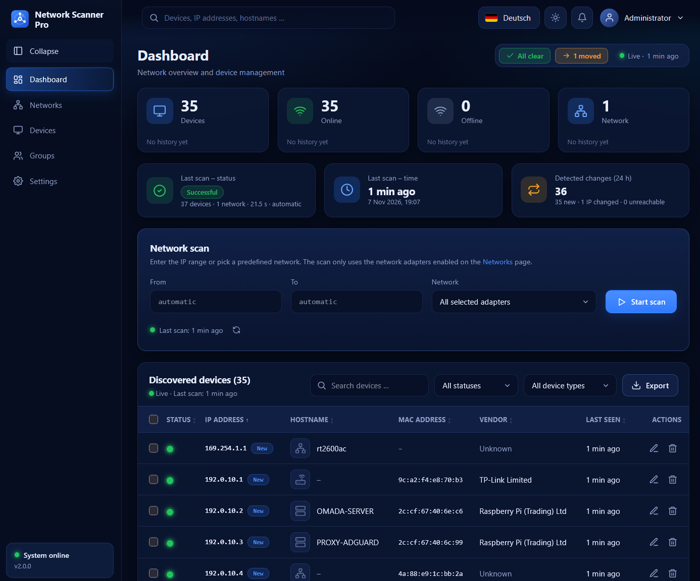
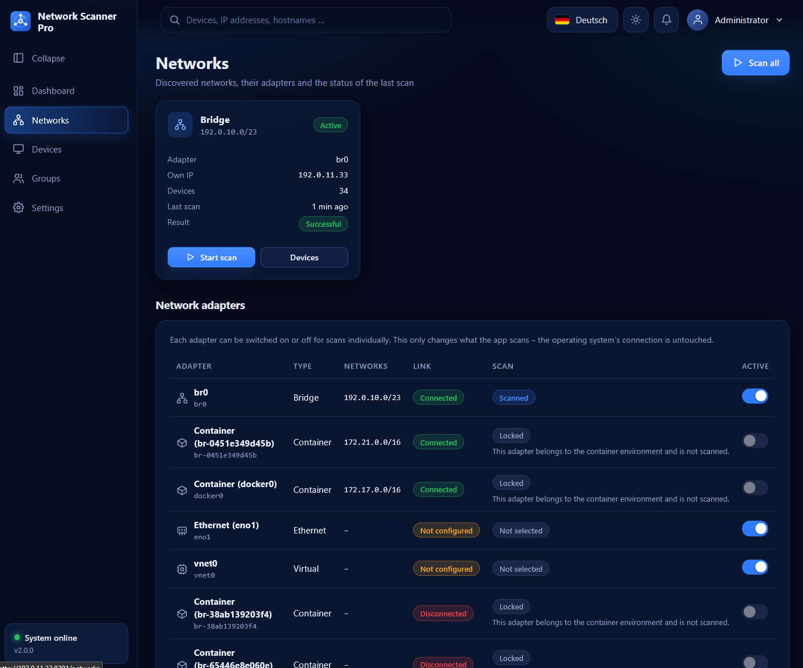
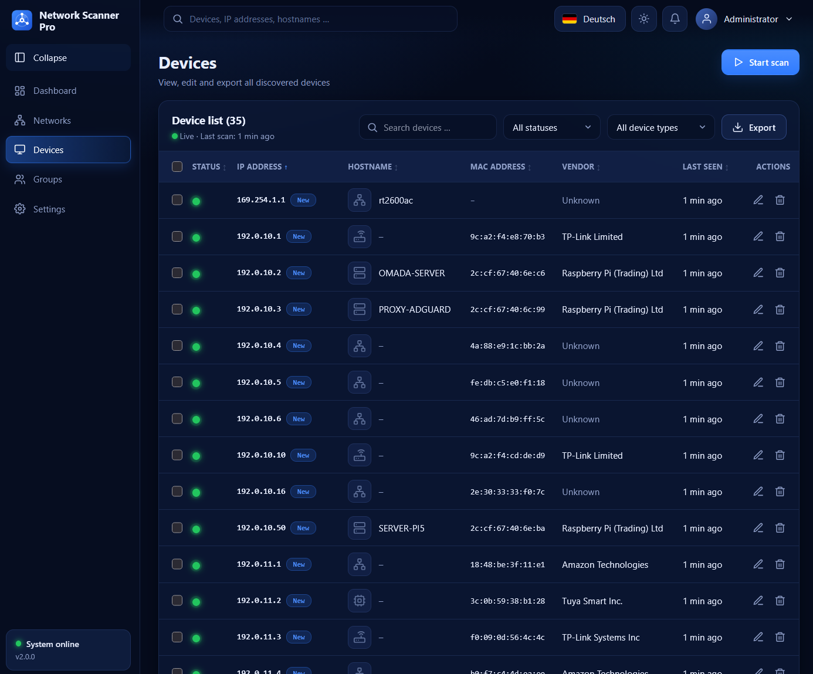
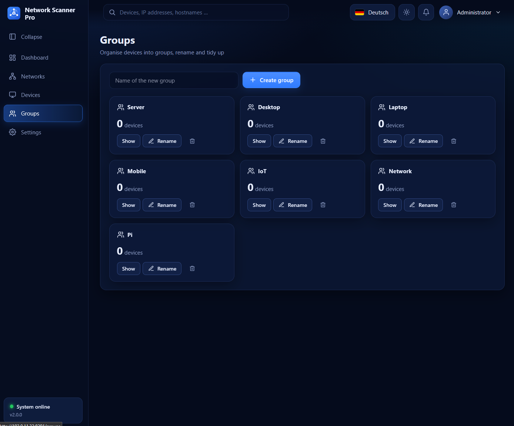
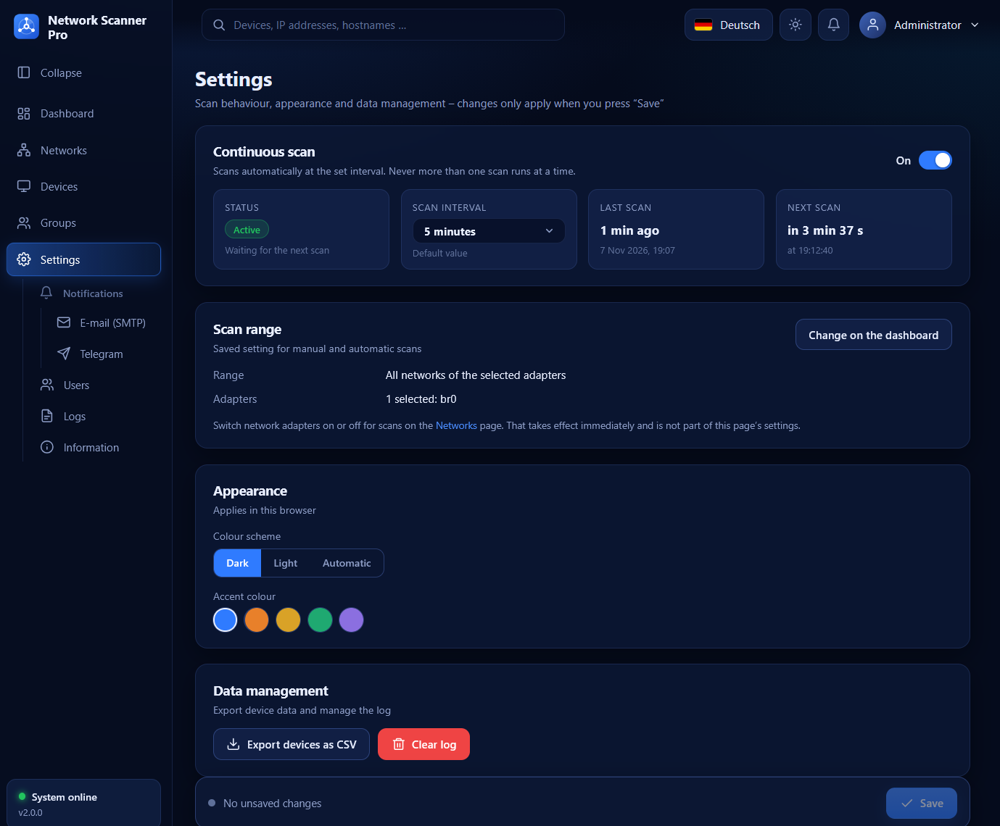

# Network Scanner Pro

Netzwerk-Scanner mit Weboberfläche: findet alle Geräte im lokalen Netzwerk, zeigt sie übersichtlich an und meldet per E-Mail oder Telegram, sobald eine unbekannte IP-Adresse auftaucht.



## Funktionen

- **Automatische Netzwerk-Suche:** Scan per Knopfdruck oder kontinuierlich im eingestellten Intervall (nmap, ergänzt durch arp-scan).
- **Geräteliste:** IP-Adresse, MAC-Adresse, Hostname, Hersteller und Gerätetyp, mit Suche, Filter und CSV-Export.
- **Änderungen im Blick:** Neue Geräte, gewechselte IP-Adressen und nicht mehr erreichbare Geräte werden erkannt.
- **Benachrichtigungen:** Sofortige Nachricht per E-Mail (SMTP) und/oder Telegram bei einer neuen, unbekannten IP-Adresse.
- **Netzwerke und Adapter:** Einzelne Netzwerkadapter lassen sich für den Scan ein- und ausschalten.
- **Benutzer und Rollen:** Anmeldung mit Administrator, Operator und Betrachter.
- **Komfort:** Deutsch und Englisch, helles und dunkles Design, Daten bleiben in Volumes erhalten.

## Screenshots

### Netzwerke und Adapter


### Geräte


### Gruppen


### Einstellungen


## Docker Compose

Nur Linux: Der Scan braucht das echte Netzwerk des Hosts. Starten mit `docker compose up -d --build`, danach ist die Oberfläche unter `http://<Server-IP>:8291` erreichbar. Beim ersten Besuch wird der Administrator angelegt.

```yaml
# Network Scanner Pro - Docker Compose (baut das Image lokal / builds the image locally)
#
#   docker compose up -d --build        bauen und starten / build and start
#   docker compose build --no-cache     komplett neu bauen / rebuild from scratch
#
# Nur das fertige Image starten (ohne Build):  docker compose -f docker-compose_run.yml up -d
#
# NUR LINUX. Scannen braucht das echte Netzwerk des Hosts. Docker Desktop (macOS/Windows) läuft in einer
# VM und sieht Ihr LAN nicht. / Linux only: scanning needs the host's real network.
#
# Daten (Datenbanken, Konfiguration, Benutzer, Logs) liegen in NSP_VOLUMES (Standard ./volumes) und
# bleiben bei Updates, Neustarts und neu gebauten Images erhalten.

name: network-scanner-pro

services:
  network-scanner-pro:
    build:
      context: .
      dockerfile: Dockerfile
      args:
        VERSION: ${VERSION:-2.0.0}
        BUILD_DATE: ${BUILD_DATE:-}
    image: network-scanner-pro:${VERSION:-2.0.0}
    container_name: network-scanner-pro
    restart: unless-stopped

    # Ohne Host-Netzwerk sähe der Container nur Docker-interne Adressen, nie Ihr LAN.
    # Ein interner Reverse-Proxy ist nicht enthalten: Port NSP_PORT (Standard 8291) wird direkt bedient.
    network_mode: host

    # Rohe Sockets für ARP/MAC-Erkennung (nmap). Nach dem Start läuft der Dienst ohne Root-Rechte.
    cap_add:
      - NET_RAW

    environment:
      TZ: ${TZ:-Europe/Vienna}
      NSP_PORT: ${NSP_PORT:-8291}
      NSP_LANGUAGE: ${NSP_LANGUAGE:-de}
      # Ersten Administrator vorab anlegen (sonst fragt die Oberfläche beim ersten Besuch danach):
      # NSP_ADMIN_USER: admin
      # NSP_ADMIN_PASSWORD: bitte-aendern-12345
      # Weitere Optionen: siehe config.ini im Config-Volume oder README.md
      # NSP_NETWORKS: 192.168.10.0/24
      # NSP_CONTINUOUS_SCAN: "true"
      # NSP_SCAN_INTERVAL: "300"

    volumes:
      - ${NSP_VOLUMES:-./volumes}/data:/var/lib/nsp/data
      - ${NSP_VOLUMES:-./volumes}/config:/var/lib/nsp/config
      - ${NSP_VOLUMES:-./volumes}/users:/var/lib/nsp/users
      - ${NSP_VOLUMES:-./volumes}/logs:/var/lib/nsp/logs

    security_opt:
      - no-new-privileges:true
    logging:
      driver: json-file
      options: { max-size: "10m", max-file: "3" }

# CasaOS: Compose-Datei als "Eigene App" importieren; NSP_VOLUMES=/DATA/AppData/network-scanner-pro setzen.
x-casaos:
  architectures: [amd64, arm64]
  main: network-scanner-pro
  author: Network Scanner Pro
  category: Network
  description:
    de_de: Netzwerk-Scanner mit Dashboard, Geräteverwaltung, Gruppen, Protokollen, Benutzerverwaltung und Benachrichtigungen.
    en_us: Network scanner with dashboard, device management, groups, logs, user management and notifications.
  tagline:
    de_de: Geräte im Netzwerk finden und verwalten
    en_us: Discover and manage devices on your network
  title:
    en_us: Network Scanner Pro
  index: /
  port_map: "8291"
  scheme: http
```
